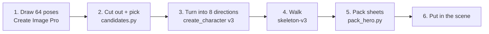

# Making a character for the Empire scene

How knight #5, the walking hero, was made, written so the next hero, NPC or guard can follow the same path. It takes about 35 PixelLab generations and an hour or two.

The result is a 32×32 sprite in the scene's own style. It has an idle and a walk in 8 directions, packed into two sheets that `src/web/src/components/Hero.tsx` plays.



## What you need

- **PixelLab MCP:** the `pixellab` server in Claude Code. The Tier 1 plan has 2,000 generations a month.
- **Python 3 and macOS `sips`:** the scripts in `design/sprites/` use only the standard library.
- **Scene style image:** `design/scene/townhall-pixellab-1x.png`, the 320×180 scene at native size.

## 1. Draw 64 front-facing poses in the scene's style

The style image is what makes a character fit the town. Character tools such as `create_character` without a reference draw in their own style. That's why the first knights (`heroes/knight`, `knight2`) looked out of place.

1. Get an upload URL with `get_upload_url`, then upload the scene:
   ```bash
   curl -sS -F "file=@design/scene/townhall-pixellab-1x.png" "<upload url>"
   ```
   The reply's `ref` (`upload:<id>`) is reusable for 3 days. The upload URL itself expires after 15 minutes.
2. Call `create_image_pro` with:
   - `width` and `height`: **24**. A 24px canvas gives 64 candidates for 10 generations, and figures about 22px tall, the right size for the town. A 20px canvas came out too crude; 32px came out too big.
   - `style_image_url`: the `upload:` ref.
   - `no_background`: true.
   - `description`: say it's tiny, full body with both feet visible, facing the viewer, with a margin, and describe the outfit. The knights' prompt is in `design/sprites/knights-64/README.md`.
3. If the person has a reference image, describe it in words rather than uploading it, unless they made it or own it. Stock art such as Shutterstock is copyrighted, and its watermarks carry over.

## 2. Cut out the candidates and pick one

Get the whole sheet with `get_image("gallery:<asset_id>")`; its `download_url` is the 192×192 sheet. Then run:

```bash
cd design/sprites
python3 candidates.py sheet.png 24 OUT_DIR
```

Don't slice the sheet by its grid, and don't use `get_image(index=n)`. The sprites spill over their cell edges, so either way gives cut-off feet and bits of the neighbours. `candidates.py` follows each sprite's own pixels instead. It writes `OUT_DIR/<n>.png` and a `contact.png`, where n = row × 8 + column, counting from 0.

To show the options:

1. **Contact sheet:** scale it up 5× with `sips -z`.
2. **Plaza preview:** paste a few picks onto the plaza at 1:1, as in `knights-64/in-scene-6x.png`.

The person picks one, and the whole set goes into a library like `design/sprites/knights-64/`.

## 3. Turn it into an 8-direction character

1. **Pad:** put the pick on a **32×32** transparent canvas, centred, feet about 4px from the bottom. The v3 turnaround refuses anything under 32px.
2. **Upload:** upload it the same way as the scene in step 1.
3. **Turn:** call `create_character` with:
   - `mode`: v3
   - `reference_image_url`: the upload
   - `n_directions`: 8
   - `view`: low top-down

   This costs 1 generation. The pick must face straight at the viewer, because whatever it faces becomes "south".
4. **Download:** get the 8 `rotations/<dir>.png` from `get_character` into `src/web/public/empire/heroes/<name>/rotations/`.

## 4. Generate the walk with the skeleton mode

Call `animate_character` with:

- `template_animation_id`: walking-4-frames
- `mode`: **skeleton-v3**
- `directions`: all 8 (3 generations each, 24 in all)

Then download every direction's frames into `walk/<dir>/0-3.png`. They come back on a 48px canvas; the packer handles that.

**Use skeleton-v3, not the plain template mode.** The template mode (1 generation a direction) redraws the character on every frame. On knight #5 it made the body narrower, darkened the helmet and dropped the sword. `breathing-idle` in template mode does the same. Skeleton-v3 moves the existing sprite, so the character stays itself. Check one direction first (3 generations) before ordering the rest. Keep rejected PixelLab output in `<name>/raw/`.

## 5. Make the idle and pack the sheets

Skip PixelLab for the idle: at this size its breathing is a blur of changing pixels. The packer makes a clear one, where the head, torso and weapon dip 1px while the feet stay planted.

```bash
cd design/sprites
python3 pack_hero.py ../../src/web/public/empire/heroes/<name>
```

It writes:

- **`idle.png`:** 4 frames × 8 directions of 32×32.
- **`walk.png`:** the same layout. Rows are in `DIRS` order: S, SW, W, NW, N, NE, E, SE.

Every direction is shifted so its feet are on row 27 and its body centred on column 16. PixelLab draws the side views a pixel higher, and its side walk straightens the legs, so without this the character floats and grows when it turns.

**Optional hand-made south idle:** put frames in `idle-south/0-3.png` (32×32) and the packer uses them for south. Knight #5's south idle came from the original pick instead of the turnaround, to keep its exact face.

**Check the result** by drawing each direction's idle frame and walk frames side by side, with lines on the helmet top and feet rows. All of them should share both lines.

## 6. Put it in the scene

`Hero.tsx` already handles:

- the sheets
- WASD and arrow-key movement in 8 directions
- road collision
- night and morning tints
- pausing while a building screen is open

For a new hero:

1. **Sheets:** point the two `url(...)` paths in the hero block of `src/web/src/styles.css` at the new `idle.png` and `walk.png`.
2. **Constants in `Hero.tsx`:** check these.

   | Constant | knight #5 | What it is |
   | --- | --- | --- |
   | `SRC_FEET` | `{ x: 16, y: 27 }` | Matches the packer's centre and feet row |
   | `SCALE` | `0.8` | Shrinks the character slightly so it sits better next to the buildings. The person asked for this; 1 is exactly the scene's pixel size |
   | `SPEED` | `42` | Scene pixels per second |
   | `START` | `{ x: 156, y: 102 }` | Must be on a road |
   | `FOOT` | `2` | Half-width of the feet that must stay on the road |

3. **Timing:** set it in CSS. The idle is 1.6s for 4 frames, the walk 0.56s.
4. **Shadow:** `heroes/shadow.png` is an 8×2 pixel ellipse in the scene's dark navy at 47% opacity, drawn under the feet.
5. **Roads:** the walkable area is `public/empire/walkable.png`, built by `design/scene/walkable.py` from the scene's road colours. Rerun it whenever the scene changes, and look at its preview before shipping.

## Lessons from the first tries

- **Shrinking a big sprite doesn't work.** A 64px or 48px character drawn smaller has finer pixels than the town, and halving it in code turns 1px outlines to mush. Draw it at the size it'll be used.
- **Recolouring isn't enough.** `design/sprites/recolor.py` can map a sprite onto the scene's 60 colours. It fixed the palette, but not the outline weight or the level of detail.
- **Batch candidates spill into each other.** Create Image Pro sheets put sprites across cell edges. Always cut with `candidates.py`.
- **Animation templates redraw the character.** Use skeleton-v3, or animate by hand, as with the idle dip.
- **Check every direction, not just south.** The side views had their own height problems that the front view didn't show.

## Costs for knight #5

| Step | Generations |
| --- | --- |
| 64 poses (Create Image Pro, 24px) | 10 |
| 8-direction turnaround (v3 with reference) | 1 |
| Walk test, template mode (rejected) | 1 |
| Breathing idle, template mode (rejected) | 1 |
| Walk, skeleton-v3, 8 directions | 24 |
| **Total** | **37** (35 without the rejected tests) |

## Files

| Path | What |
| --- | --- |
| `design/sprites/knights-64/` | The 64 knights, with their prompt and gallery ID |
| `design/sprites/candidates.py` | Cuts candidates out of a PixelLab sheet |
| `design/sprites/pack_hero.py` | Builds `idle.png` and `walk.png` |
| `design/sprites/sheet.py` | PNG reading and writing, and packing frames side by side |
| `design/scene/walkable.py` | Builds the road mask |
| `src/web/public/empire/heroes/knight5/` | Knight #5: `concept-5.png`, `rotations/`, `idle-south/`, `walk/`, `idle.png`, `walk.png`, `raw/` (rejected PixelLab output) |
| `src/web/src/components/Hero.tsx` | Movement, collision and drawing |
| PixelLab character | https://www.pixellab.ai/create-character/ff6ea1c1-ccf7-4fb0-967c-35ccf7e45e30 |
