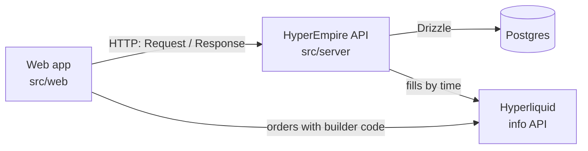

# HyperEmpire — backend

How the game runs behind the screens: the game backend (built), and the on-chain and off-chain parts planned around it. Endpoints are in [endpoints.md](endpoints.md). Running and deploying the server is in [src/server/README.md](../../src/server/README.md). The rules themselves (prices, odds, rewards) are in [the game design](../economy/game-design.md).

## The pieces



- **Web app** (`src/web`): the town, the Exchange and the building screens. It trades on Hyperliquid directly with the player's agent key, and asks the API for everything else in the game. It never computes a balance or rolls a die itself.
- **HyperEmpire API** (`src/server`): one [Hono](https://hono.dev) app in TypeScript. It holds the $aura ledger, the Townhall, Miners, Picks and mining blocks, and checks every rule.
- **Postgres:** the API's only state. One database per Hyperliquid network (testnet and mainnet never share data).
- **Hyperliquid:** the API reads each player's fills to credit $aura for the builder fees they paid.

## Where it runs

The same `createApp(deps)` serves every request in both setups. Only the database driver and the transport differ.

| | Development (now) | Production |
| --- | --- | --- |
| Started by | `src/server/src/local.ts`, loaded by the web app | `src/server/src/main.ts` with Bun |
| Transport | In-process: the web app builds a real `Request` and the app returns a real `Response` | HTTPS |
| Database | PGlite (Postgres in WebAssembly) in the browser's IndexedDB, `hyperempire-<network>` | Postgres on AWS (RDS), from `DATABASE_URL` |
| Block timer | None. Requests catch blocks up (below) | Every 60 s, plus catch-up on requests |
| Simulated players | 2,000 power in each pool, so a lone developer doesn't win everything | None |
| Web setting | `VITE_API_URL=local` (default) | `VITE_API_URL=https://<api host>` |

`src/web/src/shared/api.ts` is the only client file that knows which one is in use. Moving to production means deploying `src/server` with a database and changing `VITE_API_URL`; no client code changes.

**Several tabs, one server.** Only one tab opens the database (it holds a `navigator.locks` lock), since two tabs would run two copies of the server over one database. Every other tab, such as a second game tab or the admin dashboard, sends its requests to that tab over a `BroadcastChannel` and gets the same `Response` back, like a client of one server. When the owner tab closes, a waiting tab takes the lock and opens the database itself. A request caught in that switch fails after 15 s; reloading fixes it.

Limit of development mode: the data lives on one device and is lost if the site's data is cleared.

## Code layout

| Path | What |
| --- | --- |
| `src/contract.ts` | The API contract: request and response types and the rules the client shows. The only server module the web app imports (plus `local.ts`) |
| `src/app.ts` | `createApp(deps)`: CORS, routes, error handling |
| `src/routes/` | `auth.ts`, `me.ts`, `townhall.ts`, `mining.ts`, `admin.ts` |
| `src/rules/` | Pure game rules with no I/O: `empire.ts` (Townhall levels, the Mastery list, cap and XP bonus), `mining.ts` (grades, merges, upkeep, pools), `exchange.ts` (the daily $aura pool and shares), `mastery.ts` (the Mastery curve and Exchange perks: discount, counted fee, pool weight), `aura.ts` (units) |
| `src/ledger.ts` | Balances and the ledger |
| `src/exchange.ts` | Exchange rewards: tracks builder fees per day, weighs them with Exchange Mastery perks, settles each finished day into $aura shares and XP |
| `src/mastery.ts` | Mastery storage: XP and perk ranks per player and building, the level capped by the Townhall, adding XP with the Townhall bonus |
| `src/hyperliquid.ts`, `src/lz4.ts` | Reads a wallet's fills and Hyperliquid's daily builder-fill files (LZ4-compressed CSV) |
| `src/blocks.ts` | Mining block settlement |
| `src/db/` | Drizzle schema, SQL migrations, shared types |
| `src/deps.ts` | Everything the app gets from outside: database, network, clock, randomness, fills reader, simulated power, CORS origins, admin login |
| `src/local.ts`, `src/main.ts` | The two entry points |
| `src/app.test.ts` | End-to-end tests: real requests and a real wallet signature on an in-memory database, with a fake clock, dice and fills |

**Dependencies are injected.** Routes never call `Date.now()`, `Math.random()` or Hyperliquid directly; they use `c.var.deps`. Tests swap in a clock they move forward, dice they choose and fills they invent, so every rule (a failed upgrade, a rush win, a worn-out Pick) can be tested exactly.

**Boundaries are tested.** `src/web/src/architecture.test.ts` fails if web code imports any server module other than `@server/contract` (and `@server/local` in `shared/api.ts`), or if any server file imports web code.

## Accounts and sign-in

1. The client sends its address to `POST /auth/nonce` and gets a one-time nonce (valid 10 minutes) inside a message to sign:
   ```
   HyperEmpire wants you to sign in with your wallet.

   Address: 0x…
   Network: testnet
   Nonce: 3f9a…
   ```
2. The wallet signs it (`personal_sign`: free, no transaction). `POST /auth/verify` deletes the nonce (so it can't be used twice), checks the signature with viem, and returns a random 32-byte session token valid for 30 days.
3. Every other call sends `Authorization: Bearer <token>`. The client keeps the token in `localStorage` per network and wallet, and drops it when the API answers 401.

The first sign-in creates the account with its 5,000 starter $aura. The network is in the signed message, so a testnet signature can't sign in on mainnet.

## The $aura ledger

- **Units:** stored as integers in milli-$aura (1 $aura = 1,000 units), so fractions from block shares add up without float drift. The API returns plain $aura.
- **Two tables:** `accounts.balance` is the current balance; `ledger` has one row per change (`delta`, `kind`, `ref`). Both change in the same transaction.
- **Credits are idempotent:** a credit with a `ref` is recorded at most once per `(address, kind, ref)` (a unique index). Crediting the same fill or the same block range twice does nothing.
- **Debits can't overdraw:** a debit only updates the balance `WHERE balance >= amount`; if no row changes, the request fails with `402 not_enough_aura` and the transaction rolls back. The column also has `CHECK (balance >= 0)`.
- **Spending burns:** a debit has no other side. Burned $aura is gone.

| Kind | Sign | Ref | When |
| --- | --- | --- | --- |
| `starter` | + | `starter` | First sign-in |
| `exchange` | + | day (`YYYYMMDD`) | Share of that day's Exchange pool |
| `fee` | + | fill trade id | Old fixed-rate credits (500 per $1), before the daily pool; no longer written |
| `mine` | + | `<first block>-<last block>` | Mining payouts for a settled range |
| `townhall:upgrade` | − | | Upgrade attempt, success or not |
| `mastery:exchange:respec` | − | | Reset of Exchange Mastery perks |
| `townhall:respec` | − | | Old perk resets, before Mastery; no longer written |
| `tavern:recruit` | − | | Recruit a Miner |
| `mine:feed` | − | | Feed a Miner |
| `workshop:craft` | − | | Craft a Pick |
| `workshop:repair` | − | | Repair a Pick |

## Exchange rewards

Each UTC day has a fixed pool (`DAILY_EMISSION`, 100,000 $aura per network) shared by builder fees paid that day. The economics are in [the game design](../economy/game-design.md#earning-aura).

**Which fees count.** A Hyperliquid fill reports a `builderFee` but not which builder took it, so fills alone can't tell our fees from Phantom's.

| Network | Source of truth | How |
| --- | --- | --- |
| Mainnet | Hyperliquid's daily builder-fill file: `stats-data.hyperliquid.xyz/Mainnet/builder_fills/<our builder, lowercase>/<YYYYMMDD>.csv.lz4` | Lists every fill that paid **our** builder (columns `time,user,coin,side,px,sz,…,builder_fee`; no trade or order id). Published the next day; a day with no fills gets no file (the bucket answers 403) |
| Testnet | Fills of orders placed through our Exchange | Hyperliquid publishes no testnet files. After each order, the client reports its order ids (`POST /exchange/orders`, including TP/SL read back from open orders); only fills of those orders at our fee rate or less count |

**Through the day (pending).** On `GET /me` and `GET /exchange` (at most every 30 s per wallet), the API reads the wallet's new fills from `accounts.fills_synced_until`. That starts at sign-up, so older trades never count. Fees of reported orders go into `exchange_fees` as `fill` rows. These give each player's live estimate, `pool × your weight ÷ total weight`, shown as **pending $aura**. Nothing is credited yet.

**After the day (settled).** `settleDays()` runs lazily on `/me` and `/exchange`, and on a server every 15 minutes. For each finished day not settled yet:
1. **Mainnet:** download and decompress the day's file and store its rows as `file` rows. The live `fill` rows are ignored from here on. If the file isn't out yet, wait and retry every 10 minutes. If it's still missing 36 hours after the day ended, the day had no fills.
2. **Testnet:** use the day's `fill` rows.
3. Weigh each fill (`weighDay`) with that wallet's Exchange Mastery perks as they are now:
   - its **counted fee** = fee paid ÷ (1 − earned discount), never more than the trade's list-rate fee (price × size × list rate);
   - its **weight** = counted fee × (1 + Market maker or Taker bonus for that fill + Whale bonus if the wallet's volume that day is $100k+).
4. Write `exchange_days` (pool, total fees, total weight, players, source) and `exchange_rewards`: each wallet gets `floor(pool × weight ÷ total weight)` and `100 XP × counted fee in $`.
5. Credit each share: $aura to the ledger (`kind = 'exchange'`, `ref = day`) and XP to Exchange Mastery (with the Townhall's +1% per level). `exchange_rewards.credited` is the claim, so each day is credited once. A wallet without an account yet keeps its share, credited when it signs in. On mainnet the file lists everyone who traded through our builder, signed in or not.

Days settle in order, at most 31 per call. Inserting the `exchange_days` row is the claim, so two requests never settle the same day twice.

**Config.** `deps.builder` (`{ address, feeRate }`) turns rewards on: `BUILDER_ADDRESS` and `BUILDER_FEE_TENTHS_BPS` on a server, or the web app's `VITE_BUILDER_*` in the browser. `deps.builderFills` is set on mainnet only. The file is CORS-open, so the in-browser server can read it too.

## Townhall

Rules are in `src/rules/empire.ts`: level costs, the Mastery list, the Mastery cap and the XP bonus.

- **Upgrade:** the player picks a chance from 10% to 100% in steps of 10 and pays that share of the next level's cost. The server rolls; the $aura burns either way.
- **What the level gives:** every building's Mastery is capped at the Townhall level (`masteryCap`), and Mastery XP gets +1% per level (`masteryXpBonus`). See [Mastery](../economy/game-design.md#mastery).
- **Masteries live in their buildings:** the Townhall reports only its level, the cap and the bonus; each building's Mastery is read from `/mastery/:building`. The old perk tree and respec were removed (migration `0003` drops their columns).

## Mastery

Each player has a row per building in `masteries`: total XP (never capped), perk ranks and respecs. The level is derived: everyone starts at 1, level n → n+1 takes 100 × n² XP, and the level that counts is capped at the Townhall level (XP past it is kept). Each level gives 1 point for that building's perks; a respec costs 5,000 × 1.5^respecs × (1 + level / 20) $aura.

**Exchange Mastery** (`rules/mastery.ts`) is the first one built. XP comes from settled days (above). Its perks:
- **Lower fees:** −2% builder fee per rank, up to −20%. The API returns the player's fee (`feeTenthsBps`, in Hyperliquid's tenths of a basis point) on `/exchange` and `/mastery/exchange`; the Exchange puts it on every order.
- **Market maker, Taker, Whale:** pool weight, applied at settlement.

Other buildings' Mastery answers 404 until built.

## Mining

Rules are in `src/rules/mining.ts`. What each grade does and costs is in [the game design](../economy/game-design.md#mining-phase-2).

**Things:** a **Miner** has a grade, energy (0–100), a pool (or none), the block it arrives at, and an optional Pick. A **Pick** has a grade and durability (0–100). The Tavern recruits Miners, the Workshop crafts and repairs Picks, and both merge two of a grade into a chance at the next one (a failed merge loses both).

**Power:** Miner power × the Pick's multiplier while the Pick has durability left. A Miner mines only after it has arrived (`ready_height ≤ block`, 3 blocks of walking after a deploy) and while it has energy. Deployed Miners are capped by slots: 3 for now; Foreman (Mine Mastery) will add more.

**Blocks:** block `h` covers `GENESIS + h × 60 s` to the next minute. Each reward has a per-block prize, split between a shared and a rush pool (50/50 for $aura).

- **Shared pool:** every active Miner gets `prize × its power ÷ total power`.
- **Rush pool:** one active Miner wins the whole prize, drawn with odds by power. Each draw is recorded in `rush_wins` (with no winner if the simulated power won).
- **Wear:** every Miner that mined the block loses 100/1,440 energy (a day from full to empty) and its Pick loses 100/pick life durability.

**Settlement: lazy catch-up.** Nothing has to run every minute. Before any mining route, and on `GET /me`, `settle()`:

1. Locks the single `chain` row (`SELECT … FOR UPDATE`), so two requests never settle the same block.
2. Loads every deployed Miner and its Pick, and replays each finished block since `chain.settled_height` in memory: payouts, draws and wear, block by block.
3. Writes energy and durability back, credits each player's total with ref `<first>-<last>`, and moves `settled_height` on.

At most 10,080 blocks (a week) are replayed at once, so a long gap can't stall a request. On a server, a 60 s timer also calls `settle()`, so rush wins appear on time without anyone opening the Mine.

**Pool numbers for players:** `GET /mine` returns, for each pool, the total power, the player's power, what 1,000 more power would earn there per day, the player's expected earnings per day, and their chance per rush block. Players use these to choose where to send their Miners.

**Randomness:** recruits, crafts, merges, upgrades and rush draws use `crypto.getRandomValues`. Commit-reveal for block draws (a hidden seed published before each period, revealed after) is planned before rewards go live on mainnet.

## Data model

| Table | Key | What |
| --- | --- | --- |
| `accounts` | `address` | Balance (milli-$aura), `fills_synced_until` (starts at sign-up) |
| `exchange_orders` | `(address, oid)` | Orders placed through our Exchange, reported by the client |
| `exchange_fees` | `(day, ref)` | Builder fees per day: `fill` rows (live, from reported orders) and `file` rows (mainnet's daily file), in micro-USD, with the trade's value and taker/maker for Mastery weights |
| `exchange_days` | `day` | Settled days: pool, total fees, total weight, players, source |
| `exchange_rewards` | `(day, address)` | Each wallet's fees, weight, share (milli-$aura) and XP for a settled day, and whether it's credited yet |
| `masteries` | `(address, building)` | Mastery XP (uncapped), perk ranks and respecs per building |
| `ledger` | `id`; unique `(address, kind, ref)` | Every balance change |
| `nonces` | `nonce` | Pending sign-ins, 10-minute expiry |
| `sessions` | `token` | Session tokens, 30-day expiry |
| `townhalls` | `address` | `level` |
| `miners` | `id` | `address`, `grade` (0–4), `energy`, `pool`, `ready_height`, `pick_id` |
| `picks` | `id` | `address`, `grade` (0–4), `durability` |
| `chain` | `id` (always 1) | `settled_height`, the last settled block |
| `rush_wins` | unique `(height, pool)` | Each rush draw's winner and amount |
| `_migrations` | `id` | Applied migrations |

Addresses are stored lowercase. Migrations are SQL strings in `src/db/migrations.ts`, applied in order on start and run one statement at a time. Never edit an applied migration; add the next one.

## Admin dashboard

A read-only view of the database for the team, at `/admin.html` in the web app. It's a separate page from the game and calls the API's `/admin` routes, so it works the same with the in-browser server and a deployed one.

- **Overview:** players, $aura supply, minted and burned totals, $aura by ledger kind, Miners and Picks, the last settled block, and every table with its row count.
- **Tables:** each table's schema (columns, types, defaults, indexes) and its rows, 50 to a page, sorted by any column.
- **SQL:** one statement at a time, first 500 rows, with example queries.

**Login:** HTTP Basic auth with one username and password, kept in server config, never in the database.

| Where | Set in | Notes |
| --- | --- | --- |
| In-browser server | `ADMIN_USER`, `ADMIN_PASSWORD` in `src/web/.env.local` (git-ignored), then restart the dev server | Vite hands them to the in-browser server on the dev server only; `vite build` sets them to `null`, so they are never in a production bundle |
| Deployed server | `ADMIN_USER`, `ADMIN_PASSWORD` environment variables | Use a secret store (AWS Secrets Manager or SSM) |

Without both, or with a password shorter than 12 characters, `/admin` doesn't exist (404). The page keeps the login in memory only, so a reload asks again. After 10 wrong logins from one client (by `X-Forwarded-For`), that client waits 15 minutes. A player's session token doesn't open it.

**Read-only, two ways:** the SQL box accepts only statements that start with `SELECT`, `WITH`, `EXPLAIN`, `SHOW`, `TABLE` or `VALUES`. Each query also runs in a `READ ONLY` transaction that is always rolled back, so Postgres itself refuses writes, including a write hidden in a `WITH`. Table and column names in the table view are checked against the real schema before they reach SQL.

Values come back as JSON: big integers that don't fit a number as strings, timestamps as ISO strings, `numeric` as strings. `accounts.balance`, `ledger.delta` and `rush_wins.amount` are in milli-$aura (1,000 = 1 $aura).

## Errors

Every error is JSON with an HTTP status: `{ "error": "<code>", "message": "<readable text>" }`. The `code` is stable for code to check; the `message` can be shown to the player.

| Status | Codes | Meaning |
| --- | --- | --- |
| 400 | `bad_request` | Missing or invalid input |
| 401 | `unauthorized`, `admin_unauthorized` | No session, an expired session, a bad signature, or a wrong admin login |
| 402 | `not_enough_aura` | The balance can't cover it |
| 404 | `not_found` | No such endpoint, or not your Miner or Pick |
| 429 | `too_many_attempts` | Too many wrong admin logins; wait 15 minutes |
| 409 | `no_points`, `max_rank`, `nothing_to_reset`, `no_slots`, `grade_mismatch`, `deployed`, `equipped`, `max_grade`, `full` | A game rule says no (see [endpoints.md](endpoints.md)) |
| 500 | `internal` | A bug; details only in the server log |

## Planned around the backend

The longer-term design keeps the empire, buildings, heroes and the AURA token on HyperEVM. The fee-to-reward calculation stays off-chain, because fill history sits on HyperCore. Characters and items are stored as generic records (type, grade, stats, energy or durability), so heroes and other character types fit in later.

Data path: HyperCore fills with our builder code → the indexer totals fees per wallet each epoch → a Merkle root is posted on-chain → players claim $aura.

| Component | Where | Role | Status |
| --- | --- | --- | --- |
| Game backend | Off-chain | $aura ledger; Townhall state; Miners and Picks; rolls; 60 s block draws | **Built** (`src/server`); commit-reveal still to do |
| Fee indexer | Off-chain | Reads HyperEmpire's builder fills and computes rewards; later posts roots, then multi-signer | **Built** for the daily pool (mainnet builder files, testnet reported orders); Merkle roots still to do |
| EmpireNFT (ERC-721) | HyperEVM | $10 mint with starter $aura; Townhall level | Planned |
| Townhall | HyperEVM | Burns $aura for levels and risky upgrades (VRF or commit-reveal) | Planned (runs in the backend for now) |
| AURA (ERC-20) | HyperEVM | Transfers off in Season 0; burns on spend | Planned |
| RewardDistributor | HyperEVM | Merkle claims per epoch; daily cap per empire; leaderboard prizes | Planned |
| Tavern + HeroNFT | HyperEVM | Tiered recruits, rerolls, hero stats | Phase 3 |
| Adventure | HyperEVM | Locks a hero, resolves with stats and randomness | Phase 3 |
| Referral service | Off-chain | Records referral codes and pays the USDC fee share | Planned |

Open: when, if ever, $aura balances and Miners move from the backend on-chain.
