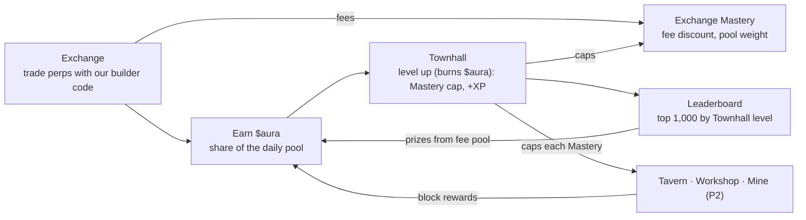
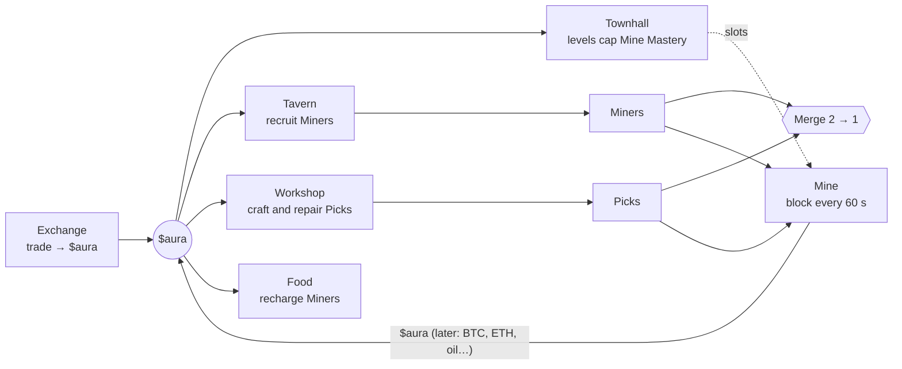

# HyperEmpire — Game Design

Oct 26, 2026 · formerly "HyperHero" and "Degen Empire"

## Pitch

HyperEmpire turns Hyperliquid trading into an empire builder: every fee you pay earns $aura, and $aura grows your empire, starting with the Townhall. Your empire is your trader identity card.

- **Who:** existing Hyperliquid traders who enjoy a game layer. Long term, a social layer for trading as esport, starting with markets like Korea.
- **How we earn:** builder-code fees on every fill routed through the Exchange, plus the $10 empire mint.
- **Phase 1 scope:** the Exchange (trading UI with our builder code), $aura from fees, empire mint with starter $aura, Townhall leveling with risky upgrades, Exchange Mastery, a Season 0 leaderboard by Townhall level, creator referral codes.

## Player types

The economy needs four groups at once: traders supply $aura, whales bring the money, low and mid-tier players bring the activity and the gear, and creators bring new players and an audience.

| | Pure traders | Whales (gamers who trade) | Low and mid tier | Content creators |
| --- | --- | --- | --- | --- |
| Why they come | Good execution, low cost | Status, competition, showing off | Thrill of luck, money from small capital | Income, audience, content |
| What they bring | Most fee revenue; $aura supply | Big spending; demand for top gear and $aura | Activity, crafted gear, an audience for whales | New players, a stage for whales |
| What keeps them | A trading UI good enough to stay; fee discounts from Exchange Mastery | Rivals and an audience | Regular small wins, a fair shot, a low entry price | Referral income (USDC), gifts, going live daily |
| What makes them leave | Fees not worth it; worthless $aura | Nobody to beat or impress | Being outspent and outrolled every time | Gifts they can't cash out; viewers who never convert |

Every new mechanic is checked against six questions:

1. **Traders:** does it give them a reason to trade here instead of on Phantom?
2. **Whales:** does it give them something to spend on or show off?
3. **Low and mid tier:** can someone with about $10–100 take part and sometimes win?
4. **Creators:** does it make something worth showing on stream?
5. **Economy:** does it create or burn $aura overall, and is the result still backed by fees?
6. **Exploits:** can bots, alts or whales break it?

## The empire

The main screen is a top-down town. Each building is a hotspot: hovering highlights the building's own shape, and clicking opens its screen.

| Building | What it does | Phase |
| --- | --- | --- |
| **Townhall** | Main progression: level up with $aura; caps every building's Mastery and boosts Mastery XP | 1 |
| **Exchange** | The trading UI: Hyperliquid perps with our builder code; fees earn a share of the daily $aura pool. Its Mastery adds a fee discount | 1 |
| **Marketplace** | Players trade $gold, crops and later every item with each other for $aura; sellers pay a 10% tax. No Mastery or rewards | later |
| **Tavern** | Recruit characters with random grades: Miners first, heroes later | 2 |
| **Workshop** | Craft Picks for Miners (later: gear); repair worn Picks | 2 |
| **Mine** | Send Miners to dig; a block of rewards every 60 s, split by mining power | 2 |
| **Garden** | Plant seeds, wait, harvest materials and potions | later |

## Roadmap

| Phase | Adds |
| --- | --- |
| 1 (now) | Exchange (trading UI, builder code); $aura from fees; empire mint with 5,000 starter $aura; Townhall leveling, risky upgrades, Exchange Mastery; Season 0 leaderboard by Townhall level; creator referral codes |
| 2 | **Mining:** Tavern recruits Miners, Workshop crafts and repairs Picks, the Mine pays block rewards; the game backend; Mine, Tavern and Workshop Mastery |
| 3 | Tavern heroes: tiered recruits and rerolls, hero stats, adventures and the free daily run; Tavern Mastery's hero perks |
| 4 | Garden, materials, gear crafting and gear NFTs (5 slots, SPD); Garden Mastery and the rest of Workshop Mastery |
| 5 | Creator live gifting and overlay, $aura transfers and a liquidity pool, PvP |

Phases 3–5 keep their old order behind mining; their order is still open.

Phase 1 details:

- **Exchange:** Hyperliquid perps with our builder code; one-time builder-fee approval at the 0.1% cap, 0.05% charged at launch; market and limit orders, TP/SL, leverage, positions and PnL, "$aura earned" on every fill. Core trading features are never locked behind levels.
- **Sinks:** Townhall levels, failed upgrade attempts and Mastery respecs. Leaderboard prizes put $aura back, so the prize pool stays small next to what they burn.
- **Creator referral codes:** a referrer earns a share of the builder fees from traders they bring in, paid in USDC. Share to decide, 10–20%.

## Core loop

$aura has two sources. **Trading** mints it from builder fees, so it's backed by revenue. **The Mine** (Phase 2) emits a fixed block reward that the team sets each week or season. Mining emission isn't backed by fees, so it's kept small next to what trading mints and what mining burns (see [Mining](#mining-phase-2)). Townhall levels, failed upgrades, respecs, recruits, crafts, failed merges, food and repairs burn $aura; leaderboard prizes come from fees.

## Earning $aura

Every UTC day, a fixed pool of $aura is shared by the builder fees paid through the Exchange that day, on opens and closes, win or lose. A player's share is the pool × their fees ÷ everyone's fees.

| Parameter | Value |
| --- | --- |
| Daily pool | 100,000 $aura per network per UTC day, set by the team (`DAILY_EMISSION`) |
| Share | Pool × your builder fees that day ÷ all builder fees that day |
| $aura per $1 of fee | Floats: high on quiet days, low on busy ones |
| Builder fee | Users approve the 0.1% perps cap; launch rate 0.05% (Phantom's level), raise toward 0.1% later |
| Counted fees | Mainnet: only fills in Hyperliquid's daily file for our builder. Testnet: fills of orders placed through our Exchange |
| Settlement | After each day ends: shares are credited once Hyperliquid publishes the day's file (mainnet) or straight away (testnet). Until then they show as pending $aura |
| Loss bonus | None (Rage Charge parked) |

Example: on a day with $200 of builder fees in total, a trader who paid $20 of them gets 10% of the pool, 10,000 $aura. On a day with $2,000 in total, the same $20 earns 1,000.

**Why a pool, not a fixed rate:** a fixed rate (it was 500 $aura per $1) pins what $aura must be worth for trading to make sense: at a 0.05% fee, $0.002 per $aura. If $aura is worth less, there's no reason to trade here. With a fixed pool, $aura per $1 floats. When few people trade, each $1 earns more, which draws traders back. When many trade, total emission stays the same, so supply is predictable and never grows with volume.

**Fee discount:** the Lower fees perk in Exchange Mastery takes up to −20% off the builder fee (−2% per rank, 10 ranks). Your share of the pool counts the fee at the list rate, so a discount never shrinks it. Perks that add pool weight (Market maker, Taker, Whale) add at most +30% to any one fill; since the pool is fixed they only shift shares between players.

**Farming guardrail:** wash trading can't raise emission, since the pool is fixed. A farmer who pays F of a day's T in fees gets F ÷ T of the pool, and every dollar they pay is builder revenue. Farming only pays while the pool is worth more than the fees it takes to win a share of it. When that happens more farmers join, which pushes fees up until it no longer does.

## $gold

$gold is the in-game currency, next to $aura. $aura is scarce and costs real trading to earn; $gold is what you spend to keep things running, so players who just want to play don't burn $aura on upkeep.

| | $aura | $gold |
| --- | --- | --- |
| Earned by | Trading (the daily pool), mining | Playing: gardening first, later quests and daily tasks |
| Supply | Fixed emission, backed by builder fees | Allowed to inflate |
| Transfers | Off in Season 0 | Never directly; traded with other players for $aura on the Marketplace (later) |
| Pays for | Power and status: Townhall levels, recruits, merges, rerolls, respecs, gear | Upkeep and comfort: food, seeds, decorations, Garden plots |

- **Rule:** nothing $gold buys may mint $aura. Trading $gold for $aura between players only moves existing $aura, so total supply stays backed by fees.
- **Marketplace (later):** players sell $gold, crops and later every item to each other for $aura; sellers pay a 10% tax in $aura (mostly burned). No Mastery and no rewards for trading there.
- **Sinks:** food and seeds, plus rising-cost sinks (decorations, plot upgrades, building skins) so $gold keeps a use once players have plenty.
- **Now:** balances and ledger exist (`GET /gold`, `$gold` in the header); nothing earns or spends $gold yet. A testing faucet gives 1,000 per claim in local development and on testnet servers that enable it.

## Townhall

The empire is a $10 NFT on HyperEVM that comes with 5,000 starter $aura and a level 1 Townhall. The Townhall is the main progression: its level ranks you on the leaderboard, caps every building's Mastery, and speeds up Mastery everywhere.

- **Level cost:** going from level L to L + 1 costs 1,000 × (L + 1)^1.6 $aura, all burned.
- **Risky upgrade:** pay 10–100% of the cost (10% steps) for the same percentage chance of success. If a level costs 10,000 $aura, 5,000 gives a 50% chance and 3,000 a 30% chance. The $aura burns either way; 100% is a sure level. Expected cost per level equals the full price, so the burn is unchanged. Attempts below 100% use commit-reveal or a VRF.
- **Mastery cap:** no building's Mastery can be higher than the Townhall level. Mastery XP keeps building up past the cap, but the level waits until the Townhall is upgraded; nothing is lost.
- **Mastery bonus:** +1% Mastery XP in every building per Townhall level.
- **Unlocks:** buildings open at Townhall levels (Tavern LV 20 and Garden LV 30 are placeholders).
- **Later:** the Townhall looks grander at certain levels in the town scene (status). Not now.

| Reach level | Cumulative $aura |
| --- | --- |
| 10 | \~150k |
| 20 | \~1M |
| 50 | \~10M |
| 100 | \~61M |

How much trading that takes depends on the daily pool (see [Earning $aura](#earning-aura)).

### Mastery

Mastery (designed Oct 28, 2026) replaces the Townhall perk tree, where every Townhall level gave a point to spend in one of three branches. Instead, **each building has its own Mastery, earned only by doing what that building is for**: traders progress by trading, gamblers by pulling and merging, cozy players by gardening.

- **Levels:** XP from the building's own actions raises its Mastery level, up to the Townhall level. Everyone starts at level 1; going from level n to n + 1 takes 100 × n² XP (the same curve for every building).
- **Points:** each Mastery level gives 1 point to spend in **that building's** perk tree. Tiers open as you invest: tier 2 after 5 points in that building, tier 3 after 15.
- **Respec:** per building, costing $aura and rising with each respec.
- **Capacity lives in Mastery:** slots and plots come from each building's own tree (Miner slots from Mine Mastery, hero slots from Tavern Mastery, plots from Garden Mastery), not from the Townhall.
- **Carries over:** Mastery doesn't reset between seasons; only the leaderboard does.
- **Losing still counts:** failed merges and bad pulls earn Mastery XP too.

| Building | Mastery XP from (amounts to tune) | Perk tree (first draft) |
| --- | --- | --- |
| **Exchange** (built) | Builder fees paid: 100 XP per $1, counted at the list rate | **Lower fees**, **Market maker**, **Taker**, **Whale** (see below) |
| **Tavern** | Recruits and merges, successful or not; adventures later | **Barracks** +1 hero slot per rank; **Drill**; **Scout**; **Swift march**; **Warlord** |
| **Workshop** | Crafts, repairs and Pick merges, successful or not | **Steady hands**; **Bulk forge**; **Salvager**; **Master artisan**; a cheaper-repairs perk |
| **Garden** | Harvests | **Green thumb** −5% growth time per rank; **more plots**; rarer seeds; decorations |
| **Mine** | Mining: blocks mined by your Miners | **Foreman** +1 Miner slot per rank (moved here); less energy drain; shorter walks between pools |

#### Exchange Mastery (built Oct 28, 2026)

XP: 100 per $1 of builder fee, counted at the list rate, credited when each day's pool settles (with the Townhall's +1% per level). With the 100 × n² curve:

| Reach Exchange Mastery | XP | Builder fees | Volume at 0.05% |
| --- | --- | --- | --- |
| 5 | 3,000 | $30 | $60k |
| 10 | 28,500 | $285 | $570k |
| 20 | 247,000 | $2.5k | $4.9M |
| 25 (every perk) | 490,000 | $4.9k | $9.8M |
| 30 | 855,500 | $8.6k | $17M |

| Perk | Effect | Ranks |
| --- | --- | --- |
| **Lower fees** | −2% builder fee per rank | 10 (−20%) |
| **Market maker** | +3% pool weight on your maker fills per rank | 5 (+15%) |
| **Taker** | +3% pool weight on your taker fills per rank | 5 (+15%) |
| **Whale** | +3% pool weight on all your fees per rank, on UTC days you trade $100k or more | 5 (+15%) |

No tier gates; maxing all four takes 25 points. Market maker and Taker never apply to the same fill, so a fill gets at most +30% (with Whale).

**How perks meet the daily pool:** the pool is fixed, so weight perks shift shares between players and never add $aura. Every perk is computed from Hyperliquid's builder file (`crossed` says taker or maker; price × size gives volume), so the same rules work on mainnet. A fill counts its fee scaled back up by the discount you earned, never more than the list-rate fee: a discount keeps your full weight, and paying less than you're entitled to (a modified client) only lowers it.

Dropped from the first draft: Streak (the daily pool already rewards trading every day, and dust trades could farm it), Disciplined, Explorer, Patron, VIP and Whale's ear (it would mint $aura outside the pool).

**Existing progress:** today's Townhall perk ranks are test data and reset when Mastery ships.

## Exchange

The Exchange building is the trading UI. It opens from the scene (or `#exchange` for players who only trade).

- **Trading:** Hyperliquid perps with our builder code on every order, close and TP/SL.
- **Onboarding:** two one-time signatures, no gas: approve the builder fee, then approve a browser trading key (it can trade, never withdraw).
- **Mastery:** trading levels up Exchange Mastery (see [Exchange Mastery](#exchange-mastery-built-oct-28-2026)): a lower builder fee (up to −20%) and more pool weight for your trading style.
- **Never gated:** market and limit orders, TP/SL and all markets are available from level 1.

## Mining (Phase 2)

Players recruit **Miners**, equip them with **Picks**, and send them to the **Mine**. Every 60 seconds the Mine produces a block of rewards, shared by mining power, like Bitcoin mining. It's the first gacha loop, and it ties together the Townhall, Exchange, Tavern, Workshop and Mine.

### Grades

Miners and Picks share five grades. Mythic is kept for heroes.

| Grade | Recruit / craft odds | Merge into next grade | Miner power | Pick multiplier |
| --- | --- | --- | --- | --- |
| Common | 70% | 50% | 10 | ×1.1 |
| Uncommon | 22% | 40% | 35 | ×1.25 |
| Rare | 6.5% | 30% | 150 | ×1.5 |
| Epic | 1.4% | 15% | 800 | ×2 |
| Legendary | 0.1% | — | 6,000 | ×3 |

- **Recruit and craft:** recruiting a Miner at the Tavern (1,000 $aura) or crafting a Pick at the Workshop (600 $aura) rolls a random grade. The $aura burns. Prices are starting points.
- **Merge:** two of the same type and grade make one of the next grade. A failure destroys both. There's no way to raise the odds. The result starts with full energy or durability.
- **Legendary is meant to be very rare:** merging up to one takes about 1,800 Commons on average (Epic about 133), and recruiting one directly is 1 in 1,000.
- **Power vs cost:** each grade's power sits a little below its average cost in Commons (Uncommon 35 vs 40, Epic 800 vs 1,333). Merging isn't free profit; it's how players fit more power into limited slots, and failures burn a lot.
- **Pity (optional):** a guaranteed Rare or better every 30 recruits. None for Epic or Legendary.

### Power and slots

- **Power:** a Miner's power = Miner power × Pick multiplier. One Pick per Miner; with no Pick, or a broken one, the Miner mines at ×1.
- **Slots:** only Miners in a slot mine. Everyone starts with **3 slots**; the Foreman perk (Mine Mastery) adds 1 per rank, **8 at most**.
- **No cap:** one player's total power is not capped.

### Upkeep

- **Hunger:** Miners are people and get hungry. Each has energy from 0 to 100 that drains while it mines; a full meal lasts about 24 hours, and at 0 it stops until fed. Feeding costs $aura and grows with grade (a day's food: Common 20, Uncommon 60, Rare 220, Epic 1,000, Legendary 6,000).
- **Durability:** a Pick wears down every block it mines (about 1 day for a Common, 7 for a Legendary). A broken Pick stays equipped with no bonus until the Workshop repairs it for $aura; cost grows with grade and wear.
- **Tuning rule:** a grade's daily upkeep is about 30–40% of what it is expected to earn at the network power we target, so mining pays but always needs topping up. Recalculated whenever block rewards change.

### Blocks and pools

- **Block:** every 60 seconds. Each reward type ($aura first; later others such as BTC, ETH or oil) has its own block reward, **set manually each week or season** and announced ahead.
- **Two pools per reward:** half of each reward's block goes to its **shared pool**, split by share of power among the Miners in it. The other half goes to its **rush pool**: one winner per block, picked with odds set by power. The split can differ per reward.
- **One pool per Miner:** each Miner works in exactly one pool, for example $aura shared or BTC rush. With two rewards there are four pools and three base slots, so placement is a real choice.
- **Rush pools can be switched off** per reward. Whether they launch is decided later.
- **Switching costs time:** moving a Miner to another pool takes it out for a few blocks while it walks. Power is counted at the start of each block, so nobody can jump in just before a payout.
- **Offline mining:** deployed Miners keep mining while the player is away, until they run out of energy.
- **Example:** an $aura block of 100 pays 50 to the shared pool and 50 to the rush pool. With 10% of the shared pool's power you get 5 $aura every block; with 10% of the rush pool's power you have a 10% chance at 50 each block.

### The Mine screen

Players choose their own pools, so the Mine shows the numbers:

- **For each pool:** its total power, its reward per block and the reward per 1,000 power per day.
- **For the player:** expected earnings per day for their own power, and in rush pools their chance per block and the average wait between wins (e.g. "1.2% per block, ~1 win every 83 min").
- **Move preview:** before a Miner switches pools, a preview of the change, e.g. "Move Rare (150) to BTC shared: +0.00002 BTC/day, −12 $aura/day, 3 blocks walking".

### Guardrails

- **Emission stays small:** the team sets block rewards so that mining emits well below the $aura minted from fees in the same period, and below what mining burns in recruits, crafts, failed merges, food and repairs.
- **Fair rolls:** every recruit, craft, merge and block draw runs on the backend. Block draws use commit-reveal: a hidden seed is published before each period and revealed after, so anyone can check them.
- **Real-asset prizes need a legal read:** a rush pool that pays real BTC to players who paid $aura for random Miners is the most gambling-like part of the design. $aura stays non-transferable, which helps. Shared pools, split by power, are easier to defend.

## Tavern and heroes (Phase 3)

Heroes come after Miners; both are characters recruited at the Tavern.

The Tavern recruits heroes. Every recruit rolls a random tier, which sets the hero's total base stats; that total is split randomly across five stats.

| Tier | Odds | Total base stats |
| --- | --- | --- |
| Common | 50% | 25 |
| Uncommon | 28% | 30 |
| Rare | 14% | 36 |
| Epic | 6% | 44 |
| Legendary | 1.8% | 54 |
| Mythic | 0.2% | 66 |

- **Spread matters too:** each stat gets at least 1, up to a per-stat cap. A Legendary with 30 INT is a crafting hero; an even split is ordinary.
- **Hero levels:** each hero level adds 1 stat point to allocate; level points are separate from base stats, so a reroll never loses them.
- **Reroll:** pay $aura (burned) to reroll tier and spread together. The new roll always replaces the old one. Cost: 5,000 × 1.5^n × (1 + level / 20), where n is the hero's reroll count. The count is stored on the NFT, so a natural Mythic with zero rerolls is its own flex.
- **Fair randomness:** recruit and reroll results come from commit-reveal or a VRF; contracts cannot recruit or reroll.
- **Hero slots:** set by Tavern level and the Barracks perk.

| Stat | Role | Who wants it |
| --- | --- | --- |
| STR | Damage in combat zones, more materials | Fighters |
| AGI | Crit and dodge, success in fast zones | Fighters |
| VIT | HP, less gear wear | Tanks, long runs |
| INT | Crafting success, magic zones | Crafters |
| LUCK | Loot drops, craft quality, crit | Everyone, crafters most |

### Adventures

Pay an entry fee in $aura, lock the hero for a set time, and stats decide whether you win.

1. Choose a zone and duration (4h, 8h or 24h). Pay the zone's entry fee in $aura.
2. The hero is locked and cannot level or start another adventure.
3. On return, success chance = f(hero stats vs zone difficulty), resolved with on-chain randomness.
4. Success returns the entry plus a reward. Failure burns the entry.

Tuning target: expected value below 1× for weak heroes, about 1.1× for strong ones. **Free daily run:** each hero gets one Rat Cellar run per day with no entry fee; it drops materials only, never $aura.

Idea under consideration: make adventures a watchable idle auto-battle with a perk draft (see Epic Idle Journey) instead of a timer and odds.

## Garden (later)

Plant seeds, wait, harvest. A light daily check-in loop for traders and low/mid players. The harvest is **materials and potions, never $aura**, so the Garden can't print currency. Seeds come from adventures or are bought with $aura. Green thumb (Crafter) speeds growth.

## Crafting, gear and materials (later)

The Workshop crafts Picks in Phase 2; gear crafting follows.

Crafting gives low and mid-tier players a role: they turn time and luck into gear NFTs that whales buy.

| Piece | Rule |
| --- | --- |
| Materials | Drop from adventures and the Garden; non-transferable in Season 0; some drop only in zones capped at hero level 20 |
| Craft cost | Materials + $aura, all burned |
| Mastery | Stored on the hero NFT, so a high-mastery crafter hero can be sold; grows with every attempt; the biggest factor in roll quality |
| Luck | Extra $aura raises the odds, with diminishing returns and a cap |
| Time | A hero either crafts or adventures, not both at once |
| Output | Gear NFT with rolled stats and random affixes; the crafter is recorded on the item |
| Durability | Gear wears with each adventure, takes a limited number of repairs, then breaks |
| Trading | Gear and heroes trade on existing NFT marketplaces (OpenSea and Drip.Trade list HyperEVM collections) |

Five gear slots; SPD comes only from gear.

| Slot | Main stats | Affix bias | Recipe |
| --- | --- | --- | --- |
| Weapon | STR, AGI | Crit-style affixes | Ore + Wood |
| Armor | VIT | Damage-reduction affixes | Ore + Hide |
| Helmet | VIT, INT | Resistance affixes | Ore + Gem |
| Shoes | AGI + **SPD** (shorter adventure locks, capped at −40%) | Speed affixes | Hide + Wood |
| Accessory | LUCK, INT | Loot and craft affixes | Gem + Essence |

| Family | T1 | T2 | T3 | T4 |
| --- | --- | --- | --- | --- |
| Ore | Iron | Steel | Mithril | Adamantite |
| Hide | Rat Hide | Wolf Hide | Wyvern Scale | Dragon Hide |
| Wood | Ash | Oak | Ironwood | Elderwood |
| Gem | Quartz | Sapphire | Ruby | Diamond |
| Essence | Faint | Pure | Ancient | Primal |

Catalysts (about 1 in 50): **Rat Fang** adds a guaranteed affix, **Goblin Coin** rerolls one stat, **Crypt Shard** raises the quality odds. Zones: Rat Cellar (4h, T1), Novice Woods (8h, T2 wood and hide, heroes up to level 20 only), Goblin Market (8h, T2 ore, gems, essence), Forgotten Crypt (24h, T3–T4 at low odds). Salvage returns 30–50% of materials.

Guardrail: gear sells for real money, which prices $aura indirectly. Gear value must stay below the builder fees behind the $aura that went into it; craft costs and failure rates are tuned to that.

## Leaderboard (Season 0)

The top 1,000 empires by **Townhall level** share a prize pool funded by a fixed share of builder fees, not by new $aura. Ties go to whoever reached the level first. Pay-to-win is intended: whales can climb by spending, which funds the system.

| Rank | Share of pool |
| --- | --- |
| #1 | 10% |
| #2–10 | 20% |
| #11–100 | 25% |
| #101–500 | 25% |
| #501–1,000 | 20% |

## Season 0 rules and guardrails

- **Transfers off:** $aura is a standard ERC-20 with a transfer flag the team turns on after Season 0; until then it works as in-game points.
- **Only fills with our builder code count.** Closes made elsewhere and liquidations earn nothing.
- **Daily emission cap per empire** catches anything the fee rule misses.
- **Pool launch (after Season 0):** seeded at or below $0.001 per $aura.

## Architecture

How the game runs (contracts, the fee indexer and the game backend) is in [docs/backend](../backend/README.md).

## Where things stand (Oct 26, 2026)

Built in `src/web` (Vite + React + wagmi + the Hyperliquid TS SDK):

- **Empire scene:** a PixelLab-generated town (`design/scene/townhall-pixellab.png`); building hotspots with shape-following hover highlights from cut-out sprites.
- **Exchange modal:** live trading on Hyperliquid testnet with the builder code, builder-fee and agent onboarding, positions, orders and fills with $aura per fill.
- **Townhall modal:** level and progress, risky upgrade, and what the level gives (Mastery cap, +1% Mastery XP per level). Each building shows its own Mastery inside that building, not in the Townhall. The perk tree is gone.
- **Exchange Mastery:** a MASTERY tab in the Exchange: XP from settled days, the four perks, the discounted builder fee on orders and the pool weights at settlement. The other buildings' Mastery isn't built yet.
- **Town:** a 480×180 world with a camera that follows a walkable knight hero: the original town, where the Garden grows wheat in two small plots, and an east strip where the Workshop and the Mine already stand as "coming soon" buildings. The town stays compact: each building opens its own screen (like the Exchange) for its full feature, so the Garden's fields will live on a Garden screen, not in the town.

**Where $aura lives today:** in the game backend's ledger (`src/server`). Each UTC day the API shares the day's 100,000 $aura pool by builder fees paid through our Exchange. On mainnet, fees come from Hyperliquid's daily file for our builder, so other builders' fees never count. On testnet, they come from fills of orders our Exchange placed. It also records every spend; Townhall level and perks live there too. During development the backend runs inside the browser on PGlite, so data stays on that device; production moves the same code and its Postgres database to AWS. The perk fee discount is display-only. The AURA token, Townhall contract, fee indexer and RewardDistributor are the next things to build.

## Open questions

- [ ] Sustainability: reward budget as a share of revenue, refundable $10 deposit instead of the mint, no-loss prizes from deposit interest (see [decisions.md](decisions.md#sustainability-ideas-to-explore-oct-27-2026))
- [ ] Referral share (10–20% of builder fees)
- [ ] Season 0 length and prize payout cadence
- [ ] Split of builder fees: $aura backing vs leaderboard pool vs team revenue
- [ ] Epoch length for reward claims (daily or weekly)
- [ ] One free Tavern recruit with the empire mint, or no heroes until Phase 2?
- [ ] One empire per wallet or several? Are empires tradable?
- [ ] Respec: rising cost (current) or free once per season?
- [ ] Building unlock levels (Tavern LV 20, Garden LV 30 are placeholders)
- [ ] Randomness source on HyperEVM: VRF provider, or commit-reveal
- [ ] Daily emission cap per empire, in $aura
- [ ] Legal review of rewards tied to leveraged trading, and region restrictions
- [ ] Mining: launch rush pools or shared only; first block reward sizes
- [ ] Mining: recruit, craft, food and repair prices; walking time between pools; pity on or off
- [ ] Mining: funding and payout of real-asset rewards (BTC and others), and whether their rush pools ever launch
- [ ] Game backend vs on-chain: when, if ever, $aura balances and Miners move on-chain
- [ ] Phase order after mining (heroes, Garden and gear, creators)

Sources for builder fee rates: [Datawallet on Phantom](https://www.datawallet.com/crypto/phantom-perpetuals-review), [CryptoTicker on MetaMask](https://cryptoticker.io/en/metamask-dex/reviews/), [CoinGecko builder rankings](https://www.coingecko.com/research/publications/top-hyperliquid-builders).
