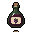

# Kitchen

The **KITCHEN** tab in the Garden's inventory turns crops into what your Farmers need: **bread** keeps them fed and **wine** keeps them happy. See [Hunger and happiness](../villagers/hunger-and-happiness.md).

## Recipes

| Step | Takes | Makes | Success |
| --- | --- | --- | --- |
| **Mill** | 5  wheat | 1  flour | 80% |
| **Bake** | 2  flour | 1  bread | 80% |
| **Ferment** | 10  grapes | 1  wine | 75% |

Each try takes its ingredients and then rolls its chance:

* **Success:** you get one of the result.
* **Failure:** the ingredients are lost.

Each step has a **1** button for a single try and an **X** button that makes as many as your ingredients allow, up to 100 at a time. Afterwards the bar shows how many worked, such as "18 of 21 worked".

## How much it takes

Failures included, on average:

| Item | Takes | Worth at market prices |
| --- | --- | --- |
| 1 bread | 15.6 wheat | about 4.7 $gold |
| 1 wine | 13.3 grapes | about 7.6 $gold |

One common wheat plant (30 wheat) makes about 2 bread. One common grape vine (40 grapes) makes about 3 wine.
