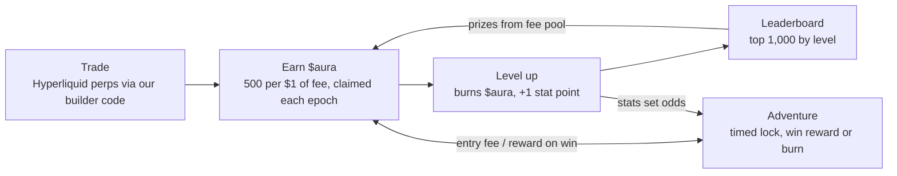

# HyperHero — MVP Design

Oct 23, 2026

## Pitch

HyperHero turns Hyperliquid trading into an RPG: every fee you pay grows your hero, and the hero becomes your trader identity card.

- **Who:** existing Hyperliquid traders who enjoy a game layer. Long term, a social layer for trading as esport, starting with markets like Korea.
- **How we earn:** builder-code fees on every fill routed through HyperHero, plus the $10 hero mint.
- **Phase 1 scope:** trading UI with our builder code, $aura from fees, tiered hero mint with rerolls, leveling with fee discount, a Season 0 level leaderboard, creator referral codes.

## Player types

The economy needs three groups at once: traders supply $aura, whales bring the money, and low and mid-tier players bring the activity and the gear.

| | Pure traders | Whales (gamers who trade) | Low and mid tier |
| --- | --- | --- | --- |
| Why they come | Good execution, low cost | Status, competition, showing off | Thrill of luck, money from small capital |
| What they bring | Most fee revenue; $aura supply | Big spending; demand for top gear and $aura | Activity, crafted gear, an audience for whales |
| What keeps them | A trading UI good enough to stay; fee discount from hero level | Rivals and an audience | Regular small wins, a fair shot, a low entry price |
| What makes them leave | Fees not worth it; worthless $aura | Nobody to beat or impress | Being outspent and outrolled every time |

Every new mechanic is checked against five questions:

1. **Traders:** does it give them a reason to trade here instead of on Phantom?
2. **Whales:** does it give them something to spend on or show off?
3. **Low and mid tier:** can someone with about $10–100 take part and sometimes win?
4. **Economy:** does it create or burn $aura overall, and is the result still backed by fees?
5. **Exploits:** can bots, alts or whales break it?

Trading UI minimum for pure traders: fast order entry, TP/SL, a chart, positions and PnL, mobile, the fee shown next to Phantom's, and "$aura earned" on every fill.

## Roadmap

Phase 1 ships a trading frontend with a progression layer: trade, earn $aura, level up, climb the Season 0 board.

| Phase | Adds |
| --- | --- |
| 1 (now) | Trading UI with builder code; $aura from fees; tiered hero mint with starter $aura and rerolls; leveling with fee discount; Season 0 leaderboard ranked by level; creator referral codes |
| 2 | Stat allocation, adventures and the free daily run |
| 3 | Crafting, materials, gear NFTs (5 slots, SPD and LUCK), salvage and durability |
| 4 | Creator live gifting and overlay, $aura transfers and a liquidity pool, PvP |

Phase 1 details:

- **Trading UI:** Hyperliquid perps with our builder code; one-time builder-fee approval at the 0.1% cap, 0.05% charged at launch; order entry, TP/SL, positions and PnL, "$aura earned" on every fill.
- **Two sinks: leveling and rerolls.** Leaderboard prizes put $aura back, so the prize pool stays small next to what leveling and rerolls burn.
- **Banked stat points:** each level still grants a point, shown as unspent until stat allocation ships in Phase 2.
- **Creator referral codes:** a referrer earns a share of the builder fees from traders they bring in, paid in USDC. Share to decide, 10–20%.
- **Hero screen:** hero, level, progress and rank; equipment and adventure panels marked as coming later.

Open for Phase 1: referral share; Season 0 length and prize payout cadence. A weekly board for small heroes is not in Phase 1.

## Core loop

Trading is the only source of new $aura; leveling and failed adventures burn it, and leaderboard prizes come from fees, not new emissions.

## Earning $aura

Every $1 of builder fee paid through HyperHero earns 500 $aura, on opens and closes, win or lose.

| Parameter | MVP value |
| --- | --- |
| Emission rate | 500 $aura per $1 builder fee (k = 0.5, ×1,000 multiplier) |
| Notional value | 1 $aura ≈ $0.001 |
| Builder fee | Users approve the 0.1% perps cap; launch rate 0.05% (Phantom's level), raise toward 0.1% later |
| Settlement | Per epoch: indexer totals builder fees per wallet, posts a Merkle root, players claim |
| Loss bonus | None in MVP (Rage Charge parked) |

Example: a $10k taker round trip at 0.1% pays $20 in builder fees and earns 10,000 $aura.

Fee discount: every 10 hero levels cut the builder fee by 5%, up to 40% off at level 80. Spending $aura to level pays traders back as cheaper trading. $aura is still earned on the fee actually paid, so the farming math is unchanged.

Farming guardrail: hedged wash trading only pays if $aura trades above about $0.002 (0.1% fee) or $0.0038 (0.05% fee). Any future liquidity pool launches at or below $0.001.

## Hero and leveling

A hero is a $10 ERC-721 on HyperEVM that comes with 5,000 starter $aura; leveling burns $aura on a steep curve, so whales burn the most.

- **Stats:** STR, AGI, VIT, INT, LUCK. Base stats come from the hero's tier, rolled at mint; each level adds 1 point the player allocates freely.
- **Level cost:** cost(L) = 1,000 × L^1.6 $aura, all burned.
- **What stats do:** set adventure success odds once adventures ship in Phase 2; in Phase 1 points are banked. PvP and combat come later.

**Risky level-up:** a player can pay a fraction of a level's cost for the same fraction as a success chance, from 10% to 100% in 10% steps. If the level costs 10,000 $aura, 5,000 gives a 50% chance and 3,000 a 30% chance. The $aura is burned either way. Expected cost per level stays the same as paying in full, so the burn is unchanged; small players get a cheap shot and whales can still pay 100% for a sure level. Attempts below 100% use the same commit-reveal or VRF as rerolls.

| Reach level | Cumulative $aura | Builder fees at 500/$1 | Volume filled at 0.1% |
| --- | --- | --- | --- |
| 10 | \~150k | \~$300 | \~$300k |
| 20 | \~1M | \~$2k | \~$2M |
| 50 | \~10M | \~$20k | \~$20M |
| 100 | \~61M | \~$122k | \~$122M |

Numbers are a starting point; the economy simulation will tune the base and exponent.

## Hero tiers and rerolls

Every mint rolls a random tier, which sets the hero's total base stats; that total is split randomly across the five stats. Tiered mint and rerolls ship in Phase 1.

| Tier | Odds | Total base stats |
| --- | --- | --- |
| Common | 50% | 25 |
| Uncommon | 28% | 30 |
| Rare | 14% | 36 |
| Epic | 6% | 44 |
| Legendary | 1.8% | 54 |
| Mythic | 0.2% | 66 |

- **Spread matters too:** each stat gets at least 1, up to a per-stat cap. A Legendary with 30 INT is a crafting hero; an even split is ordinary.
- **Level points are separate** from base stats, so a reroll never loses leveling progress.
- **Reroll:** pay $aura (burned) to reroll tier and spread together. The new roll always replaces the old one, even when it is worse.
- **Reroll cost:** 5,000 × 1.5^n × (1 + level / 20) $aura, where n is the number of rerolls that hero has had. A new hero's first reroll costs about the 5,000 starter $aura; by the fifth, minting a new hero is often cheaper; high-level heroes cost the most, making whale rerolls the biggest sink.
- **Reroll count** is stored on the NFT and shown on the hero card, so a natural Mythic with zero rerolls is its own flex.
- **Fair randomness:** mint and reroll results come from commit-reveal or a VRF, and contracts cannot mint or reroll, so nobody can cancel a bad roll.

| Stat | Future role | Who wants it |
| --- | --- | --- |
| STR | Damage in combat zones, more materials | Fighters |
| AGI | Crit and dodge, success in fast zones | Fighters |
| VIT | HP, less gear wear | Tanks, long runs |
| INT | Crafting success, magic zones | Crafters |
| LUCK | Loot drops, craft quality, crit | Everyone, crafters most |

## Adventure

One adventure type: pay an entry fee in $aura, lock the hero for a set time, and stats decide whether you win.

1. Choose a zone and duration (4h, 8h or 24h). Pay the zone's entry fee in $aura.
2. The hero is locked and cannot level or start another adventure.
3. On return, success chance = f(hero stats vs zone difficulty), resolved with on-chain randomness.
4. Success returns the entry plus a reward. Failure burns the entry.

Tuning target: expected value below 1× for weak heroes, about 1.1× for strong ones, so stats pay off and adventures burn $aura overall. Materials are not in MVP; crafting ships later.

Free daily run: each hero gets one Rat Cellar run per day with no entry fee. It drops materials only, never $aura, so players who don't trade still have a way in without printing $aura.

## Global leaderboard

The top 1,000 heroes by level share a prize pool funded by a fixed share of builder fees, not by new $aura.

- **Rank:** hero level; ties go to whoever reached the level first.
- **Pay-to-win is intended:** whales may buy their way up (once transfers open), which keeps the system funded.
- **Prizes:** paid in $aura each period from the fee-funded pool, so payouts stay below what top players spent.

| Rank | Share of pool |
| --- | --- |
| #1 | 10% |
| #2–10 | 20% |
| #11–100 | 25% |
| #101–500 | 25% |
| #501–1,000 | 20% |

## Season 0 rules and guardrails

In Season 0, $aura cannot be transferred and has no liquidity pool, so it works as in-game points with no cash value.

- **Transfers off:** standard ERC-20 with a transfer flag the team turns on at the end of Season 0.
- **Sinks:** leveling and adventure entries burn $aura; cosmetics and crafting add more later.
- **Daily emission cap per hero** catches anything the fee rule misses.
- **Only fills that carry the HyperHero builder code count.** Closes made elsewhere and liquidations earn nothing.
- **Pool launch (post Season 0):** seeded at or below $0.001 per $aura, under the farming break-even.

## Architecture

Heroes, levels and $aura live on HyperEVM; only the fee-to-reward calculation runs off-chain, because fill history sits on HyperCore.

Data path: HyperCore fills with our builder code → indexer totals fees per wallet each epoch → Merkle root posted on-chain → players claim $aura.

| Component | Where | Role |
| --- | --- | --- |
| HeroNFT (ERC-721) | HyperEVM | $10 mint; stores tier, base stats, level and reroll count; rolls by commit-reveal or VRF |
| AURA (ERC-20) | HyperEVM | Token with transfers off in Season 0; burns on spend |
| RewardDistributor | HyperEVM | Merkle claims per epoch, daily cap per hero |
| Leveling | HyperEVM | Burns $aura by cost(L), assigns stat points |
| Adventure | HyperEVM | Locks a hero, resolves with stats and randomness |
| Leaderboard | Read from HeroNFT | Ranks by level; prizes paid via RewardDistributor |
| Fee indexer | Off-chain | Reads builder fills, computes rewards, posts roots; later multi-signer |

## Crafting (after MVP)

Crafting gives low and mid-tier players a role: they turn time and luck into gear NFTs that whales buy.

| Piece | Rule |
| --- | --- |
| Materials | Drop from adventures; non-transferable in Season 0; some drop only in zones capped at hero level 20 |
| Craft cost | Materials + $aura, all burned |
| Mastery | Stored on the hero NFT, so a high-mastery crafter hero can be sold; grows with every attempt, failures included; the biggest factor in roll quality |
| Luck | Extra $aura raises the odds, with diminishing returns and a cap |
| Time | A hero either crafts or adventures, not both at once, so heroes specialize |
| Output | Gear NFT with stats rolled within a range plus random affixes; the crafter is recorded on the item |
| Durability | Gear wears with each adventure, takes a limited number of repairs, then breaks |
| Trading | Gear and heroes trade freely on existing NFT marketplaces (OpenSea and Drip.Trade both list HyperEVM collections); no in-house market for now |

Why whales keep buying:

- **Builds, not gear score:** the leaderboard stays ranked by level. Zones weight stats differently (e.g. Forgotten Crypt checks VIT and AGI, Goblin Market checks STR), so no single build wins everywhere.
- **Perfect-roll chase:** rolled stats and affixes make the best items rare; crafters roll many times to find them.
- **Durability and status:** gear wears out and gets replaced, and rare gear shows on the hero card.

Guardrail: gear sells for real money, which prices $aura indirectly. The market value of crafted gear must stay below the builder fees behind the $aura that went into it, so craft costs and failure rates are tuned to that and gear floor prices are watched.

Open for crafting: a declared ERC-2981 crafter royalty (marketplaces may not enforce it); quality tier odds; the affix list; set bonuses.

## Gear and materials

Five gear slots, each with one job; SPD comes only from gear; gear also boosts the five base stats, so builds come from tier, level points and gear together.

| Slot | Main stats | Affix bias | Recipe (base + secondary) |
| --- | --- | --- | --- |
| Weapon | STR, AGI | Crit-style affixes | Ore + Wood |
| Armor | VIT | Damage-reduction affixes | Ore + Hide |
| Helmet | VIT, INT | Resistance affixes | Ore + Gem |
| Shoes | AGI + **SPD** (gear-only: shorter adventure locks, capped at −40%) | Speed affixes | Hide + Wood |
| Accessory (ring or necklace) | LUCK, INT | Loot and craft affixes | Gem + Essence |

Materials come in five families and four tiers. The material tier sets the gear's stat range.

| Family | T1 | T2 | T3 | T4 |
| --- | --- | --- | --- | --- |
| Ore | Iron | Steel | Mithril | Adamantite |
| Hide | Rat Hide | Wolf Hide | Wyvern Scale | Dragon Hide |
| Wood | Ash | Oak | Ironwood | Elderwood |
| Gem | Quartz | Sapphire | Ruby | Diamond |
| Essence | Faint | Pure | Ancient | Primal |

Catalysts are rare drops (about 1 in 50) that change one craft: **Rat Fang** adds a guaranteed affix, **Goblin Coin** rerolls one stat, **Crypt Shard** raises the quality odds.

| Zone | Lock | Main drops | Note |
| --- | --- | --- | --- |
| Rat Cellar | 4h | T1 Ore, Hide, Wood; Rat Fang | Starter |
| Novice Woods | 8h | T2 Wood and Wolf Hide | Heroes up to level 20 only, so whale mains can't farm it |
| Goblin Market | 8h | T2 Ore, Gems, Essence; Goblin Coin | |
| Forgotten Crypt | 24h | T3 and T4 drops at low odds; Crypt Shard | Endgame |

- **Salvage:** breaking unwanted gear returns 30–50% of its materials.
- **Durability:** gear wears with each adventure and breaks after a few repairs.

## Later, and open questions

**After MVP:** loss bonus (Rage Charge), crafting (above), a seasonal leaderboard for low- and mid-spend players, battle-scar badges, PvP, guilds, $aura transfers and pool.

- [ ] Split of builder fees: $aura backing vs leaderboard pool vs team revenue
- [ ] Epoch length for reward claims (daily or weekly)
- [ ] Randomness source on HyperEVM: VRF provider, or commit-reveal for MVP stakes
- [ ] Daily emission cap per hero, in $aura
- [ ] Leaderboard payout cadence
- [ ] Legal review of rewards tied to leveraged trading, and region restrictions

Sources for builder fee rates: [Datawallet on Phantom](https://www.datawallet.com/crypto/phantom-perpetuals-review), [CryptoTicker on MetaMask](https://cryptoticker.io/en/metamask-dex/reviews/), [CoinGecko builder rankings](https://www.coingecko.com/research/publications/top-hyperliquid-builders).
