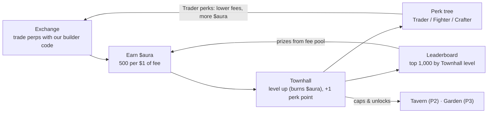

# Degen Empire — Game Design

Oct 25, 2026 · formerly "HyperHero"

## Pitch

Degen Empire turns Hyperliquid trading into an empire builder: every fee you pay earns $aura, and $aura grows your empire, starting with the Townhall. Your empire is your trader identity card.

- **Who:** existing Hyperliquid traders who enjoy a game layer. Long term, a social layer for trading as esport, starting with markets like Korea.
- **How we earn:** builder-code fees on every fill routed through the Exchange, plus the $10 empire mint.
- **Phase 1 scope:** the Exchange (trading UI with our builder code), $aura from fees, empire mint with starter $aura, Townhall leveling with risky upgrades and the perk tree (Trader branch live), a Season 0 leaderboard by Townhall level, creator referral codes.

## Player types

The economy needs four groups at once: traders supply $aura, whales bring the money, low and mid-tier players bring the activity and the gear, and creators bring new players and an audience.

| | Pure traders | Whales (gamers who trade) | Low and mid tier | Content creators |
| --- | --- | --- | --- | --- |
| Why they come | Good execution, low cost | Status, competition, showing off | Thrill of luck, money from small capital | Income, audience, content |
| What they bring | Most fee revenue; $aura supply | Big spending; demand for top gear and $aura | Activity, crafted gear, an audience for whales | New players, a stage for whales |
| What keeps them | A trading UI good enough to stay; fee discounts from the Exchange and Trader perks | Rivals and an audience | Regular small wins, a fair shot, a low entry price | Referral income (USDC), gifts, going live daily |
| What makes them leave | Fees not worth it; worthless $aura | Nobody to beat or impress | Being outspent and outrolled every time | Gifts they can't cash out; viewers who never convert |

Every new mechanic is checked against six questions:

1. **Traders:** does it give them a reason to trade here instead of on Phantom?
2. **Whales:** does it give them something to spend on or show off?
3. **Low and mid tier:** can someone with about $10–100 take part and sometimes win?
4. **Creators:** does it make something worth showing on stream?
5. **Economy:** does it create or burn $aura overall, and is the result still backed by fees?
6. **Exploits:** can bots, alts or whales break it?

## The empire

The main screen is a top-down town. Each building is a hotspot: hovering highlights the building's own shape, and clicking opens its screen.

| Building | What it does | Phase |
| --- | --- | --- |
| **Townhall** | Main progression: level up with $aura, earn perk points, set every other building's level cap | 1 |
| **Exchange** | The trading UI: Hyperliquid perps with our builder code; every fill earns $aura. Levels add a fee discount | 1 |
| **Tavern** | Recruit heroes with random tiers; reroll them | 2 |
| **Garden** | Plant seeds, wait, harvest materials and potions | 3 |

## Roadmap

| Phase | Adds |
| --- | --- |
| 1 (now) | Exchange (trading UI, builder code); $aura from fees; empire mint with 5,000 starter $aura; Townhall leveling, risky upgrades, perk tree (Trader branch live); Season 0 leaderboard by Townhall level; creator referral codes |
| 2 | Tavern: tiered hero recruits and rerolls; hero stats; adventures and the free daily run; Fighter perks go live |
| 3 | Garden, crafting, materials, gear NFTs (5 slots, SPD); Crafter perks go live |
| 4 | Creator live gifting and overlay, $aura transfers and a liquidity pool, PvP |

Phase 1 details:

- **Exchange:** Hyperliquid perps with our builder code; one-time builder-fee approval at the 0.1% cap, 0.05% charged at launch; market and limit orders, TP/SL, leverage, positions and PnL, "$aura earned" on every fill. Core trading features are never locked behind levels.
- **Sinks:** Townhall levels, failed upgrade attempts and perk respecs. Leaderboard prizes put $aura back, so the prize pool stays small next to what they burn.
- **Banked perk points:** Fighter and Crafter points can be spent now and start working in Phases 2–3.
- **Creator referral codes:** a referrer earns a share of the builder fees from traders they bring in, paid in USDC. Share to decide, 10–20%.

## Core loop

Trading is the only source of new $aura. Townhall levels, failed upgrades and respecs burn it, and leaderboard prizes come from fees, not new emissions.

## Earning $aura

Every $1 of builder fee paid through the Exchange earns 500 $aura, on opens and closes, win or lose.

| Parameter | Value |
| --- | --- |
| Emission rate | 500 $aura per $1 builder fee (k = 0.5, ×1,000 multiplier) |
| Notional value | 1 $aura ≈ $0.001 |
| Builder fee | Users approve the 0.1% perps cap; launch rate 0.05% (Phantom's level), raise toward 0.1% later |
| Settlement | Per epoch: indexer totals builder fees per wallet, posts a Merkle root, players claim |
| Loss bonus | None (Rage Charge parked) |

Example: a $10k taker round trip at 0.1% pays $20 in builder fees and earns 10,000 $aura.

**Fee discount:** Exchange building levels and Trader perks (Lower fees, −1% per rank) stack, capped at −40% in total. $aura is earned on the fee actually paid, so the farming math is unchanged. Perks that add $aura (Streak, Market maker) are capped at about +10% in total so emissions stay under the farming break-even.

**Farming guardrail:** hedged wash trading only pays if $aura trades above about $0.002 (0.1% fee) or $0.0038 (0.05% fee). Any future liquidity pool launches at or below $0.001.

## Townhall

The empire is a $10 NFT on HyperEVM that comes with 5,000 starter $aura and a level 1 Townhall. The Townhall is the main progression: its level ranks you on the leaderboard and caps every other building.

- **Level cost:** going from level L to L + 1 costs 1,000 × (L + 1)^1.6 $aura, all burned.
- **Risky upgrade:** pay 10–100% of the cost (10% steps) for the same percentage chance of success. If a level costs 10,000 $aura, 5,000 gives a 50% chance and 3,000 a 30% chance. The $aura burns either way; 100% is a sure level. Expected cost per level equals the full price, so the burn is unchanged. Attempts below 100% use commit-reveal or a VRF.
- **Building caps:** no building can be a higher level than the Townhall. The Tavern unlocks at Townhall LV 20 and the Garden at LV 30 (placeholders).

| Reach level | Cumulative $aura | Builder fees at 500/$1 | Volume filled at 0.1% |
| --- | --- | --- | --- |
| 10 | \~150k | \~$300 | \~$300k |
| 20 | \~1M | \~$2k | \~$2M |
| 50 | \~10M | \~$20k | \~$20M |
| 100 | \~61M | \~$122k | \~$122M |

### Perk tree

Each Townhall level gives **1 perk point**. Players spend points on perk ranks in three branches, one per player type. Deeper tiers open as you invest in a branch: tier 2 after 5 points in it, tier 3 after 15. **Respec** costs 5,000 × 1.5^n × (1 + level / 20) $aura, rising with every respec.

| Tier | Trader (live in Phase 1) | Fighter (Phase 2) | Crafter (Phase 3) |
| --- | --- | --- | --- |
| 1 | **Lower fees** −1% builder fee per rank (0/5) | **Drill** +1 ATK and DEF for all heroes per rank (0/5) | **Green thumb** −5% garden growth time per rank (0/5) |
| 1 | **Streak** +1% $aura per rank for each day of your trading streak, 7 days max (0/3) | **Barracks** +1 hero slot in the Tavern per rank (0/3) | **Salvager** +5% materials from salvage per rank (0/5) |
| 2 | **Market maker** +5% $aura on maker fills per rank (0/3) | **Scout** +3% adventure success odds per rank (0/5) | **Steady hands** +3% craft quality odds per rank (0/5) |
| 2 | **Patron** +5% referral share per rank (0/3) | **Swift march** −5% adventure lock time per rank (0/3) | **Bulk forge** −5% $aura cost to craft per rank (0/3) |
| 3 | **Whale's ear** once a day, 10% of one trade's builder fee back as $aura (0/1) | **Warlord** heroes start every adventure with a free buff (0/1) | **Master artisan** crafts can roll one extra affix (0/1) |

Points spent in Fighter or Crafter before Phases 2–3 are banked and start working when heroes and crafting arrive.

## Exchange

The Exchange building is the trading UI. It opens from the scene (or `#exchange` for players who only trade).

- **Trading:** Hyperliquid perps with our builder code on every order, close and TP/SL.
- **Onboarding:** two one-time signatures, no gas: approve the builder fee, then approve a browser trading key (it can trade, never withdraw).
- **Levels:** Exchange levels add a fee discount, shared with Trader perks under the −40% cap. Exchange level can't exceed Townhall level.
- **Never gated:** market and limit orders, TP/SL and all markets are available from level 1.

## Tavern and heroes (Phase 2)

The Tavern recruits heroes. Every recruit rolls a random tier, which sets the hero's total base stats; that total is split randomly across five stats.

| Tier | Odds | Total base stats |
| --- | --- | --- |
| Common | 50% | 25 |
| Uncommon | 28% | 30 |
| Rare | 14% | 36 |
| Epic | 6% | 44 |
| Legendary | 1.8% | 54 |
| Mythic | 0.2% | 66 |

- **Spread matters too:** each stat gets at least 1, up to a per-stat cap. A Legendary with 30 INT is a crafting hero; an even split is ordinary.
- **Hero levels:** each hero level adds 1 stat point to allocate; level points are separate from base stats, so a reroll never loses them.
- **Reroll:** pay $aura (burned) to reroll tier and spread together. The new roll always replaces the old one. Cost: 5,000 × 1.5^n × (1 + level / 20), where n is the hero's reroll count. The count is stored on the NFT, so a natural Mythic with zero rerolls is its own flex.
- **Fair randomness:** recruit and reroll results come from commit-reveal or a VRF; contracts cannot recruit or reroll.
- **Hero slots:** set by Tavern level and the Barracks perk.

| Stat | Role | Who wants it |
| --- | --- | --- |
| STR | Damage in combat zones, more materials | Fighters |
| AGI | Crit and dodge, success in fast zones | Fighters |
| VIT | HP, less gear wear | Tanks, long runs |
| INT | Crafting success, magic zones | Crafters |
| LUCK | Loot drops, craft quality, crit | Everyone, crafters most |

### Adventures

Pay an entry fee in $aura, lock the hero for a set time, and stats decide whether you win.

1. Choose a zone and duration (4h, 8h or 24h). Pay the zone's entry fee in $aura.
2. The hero is locked and cannot level or start another adventure.
3. On return, success chance = f(hero stats vs zone difficulty), resolved with on-chain randomness.
4. Success returns the entry plus a reward. Failure burns the entry.

Tuning target: expected value below 1× for weak heroes, about 1.1× for strong ones. **Free daily run:** each hero gets one Rat Cellar run per day with no entry fee; it drops materials only, never $aura.

Idea under consideration: make adventures a watchable idle auto-battle with a perk draft (see Epic Idle Journey) instead of a timer and odds.

## Garden (Phase 3)

Plant seeds, wait, harvest. A light daily check-in loop for traders and low/mid players. The harvest is **materials and potions, never $aura**, so the Garden can't print currency. Seeds come from adventures or are bought with $aura. Green thumb (Crafter) speeds growth.

## Crafting, gear and materials (Phase 3)

Crafting gives low and mid-tier players a role: they turn time and luck into gear NFTs that whales buy.

| Piece | Rule |
| --- | --- |
| Materials | Drop from adventures and the Garden; non-transferable in Season 0; some drop only in zones capped at hero level 20 |
| Craft cost | Materials + $aura, all burned |
| Mastery | Stored on the hero NFT, so a high-mastery crafter hero can be sold; grows with every attempt; the biggest factor in roll quality |
| Luck | Extra $aura raises the odds, with diminishing returns and a cap |
| Time | A hero either crafts or adventures, not both at once |
| Output | Gear NFT with rolled stats and random affixes; the crafter is recorded on the item |
| Durability | Gear wears with each adventure, takes a limited number of repairs, then breaks |
| Trading | Gear and heroes trade on existing NFT marketplaces (OpenSea and Drip.Trade list HyperEVM collections) |

Five gear slots; SPD comes only from gear.

| Slot | Main stats | Affix bias | Recipe |
| --- | --- | --- | --- |
| Weapon | STR, AGI | Crit-style affixes | Ore + Wood |
| Armor | VIT | Damage-reduction affixes | Ore + Hide |
| Helmet | VIT, INT | Resistance affixes | Ore + Gem |
| Shoes | AGI + **SPD** (shorter adventure locks, capped at −40%) | Speed affixes | Hide + Wood |
| Accessory | LUCK, INT | Loot and craft affixes | Gem + Essence |

| Family | T1 | T2 | T3 | T4 |
| --- | --- | --- | --- | --- |
| Ore | Iron | Steel | Mithril | Adamantite |
| Hide | Rat Hide | Wolf Hide | Wyvern Scale | Dragon Hide |
| Wood | Ash | Oak | Ironwood | Elderwood |
| Gem | Quartz | Sapphire | Ruby | Diamond |
| Essence | Faint | Pure | Ancient | Primal |

Catalysts (about 1 in 50): **Rat Fang** adds a guaranteed affix, **Goblin Coin** rerolls one stat, **Crypt Shard** raises the quality odds. Zones: Rat Cellar (4h, T1), Novice Woods (8h, T2 wood and hide, heroes up to level 20 only), Goblin Market (8h, T2 ore, gems, essence), Forgotten Crypt (24h, T3–T4 at low odds). Salvage returns 30–50% of materials.

Guardrail: gear sells for real money, which prices $aura indirectly. Gear value must stay below the builder fees behind the $aura that went into it; craft costs and failure rates are tuned to that.

## Leaderboard (Season 0)

The top 1,000 empires by **Townhall level** share a prize pool funded by a fixed share of builder fees, not by new $aura. Ties go to whoever reached the level first. Pay-to-win is intended: whales can climb by spending, which funds the system.

| Rank | Share of pool |
| --- | --- |
| #1 | 10% |
| #2–10 | 20% |
| #11–100 | 25% |
| #101–500 | 25% |
| #501–1,000 | 20% |

## Season 0 rules and guardrails

- **Transfers off:** $aura is a standard ERC-20 with a transfer flag the team turns on after Season 0; until then it works as in-game points.
- **Only fills with our builder code count.** Closes made elsewhere and liquidations earn nothing.
- **Daily emission cap per empire** catches anything the fee rule misses.
- **Pool launch (after Season 0):** seeded at or below $0.001 per $aura.

## Architecture

The empire, buildings, heroes and $aura live on HyperEVM; only the fee-to-reward calculation runs off-chain, because fill history sits on HyperCore.

Data path: HyperCore fills with our builder code → indexer totals fees per wallet each epoch → Merkle root posted on-chain → players claim $aura.

| Component | Where | Role |
| --- | --- | --- |
| EmpireNFT (ERC-721) | HyperEVM | $10 mint with starter $aura; stores Townhall level and perk ranks |
| Townhall | HyperEVM | Burns $aura for levels, risky upgrades (VRF or commit-reveal) and respecs; assigns perk points |
| AURA (ERC-20) | HyperEVM | Transfers off in Season 0; burns on spend |
| RewardDistributor | HyperEVM | Merkle claims per epoch; daily cap per empire; leaderboard prizes |
| Tavern + HeroNFT (Phase 2) | HyperEVM | Tiered recruits, rerolls, hero stats |
| Adventure (Phase 2) | HyperEVM | Locks a hero, resolves with stats and randomness |
| Fee indexer | Off-chain | Reads builder fills, computes rewards, posts roots; later multi-signer |
| Referral service | Off-chain | Records referral codes and pays the USDC fee share |

## Where things stand (Oct 25, 2026)

Built in `src/web` (Vite + React + wagmi + the Hyperliquid TS SDK):

- **Empire scene:** a PixelLab-generated town (`design/scene/townhall-pixellab.png`); building hotspots with shape-following hover highlights from cut-out sprites.
- **Exchange modal:** live trading on Hyperliquid testnet with the builder code, builder-fee and agent onboarding, positions, orders and fills with $aura per fill.
- **Townhall modal:** level and progress, risky upgrade, the three-branch perk tree with PixelLab icons, respec and building caps.

**Where $aura lives today:** nowhere permanent. Earned $aura is recalculated in the browser from each fill's `builderFee` × 500 (an estimate: it also counts other builders' fees, and Hyperliquid returns only recent fills). Townhall level, perks and $aura spent are kept in the browser's localStorage per wallet. The perk fee discount is display-only. The AURA token, Townhall contract, fee indexer and RewardDistributor are the next things to build.

## Open questions

- [ ] Referral share (10–20% of builder fees)
- [ ] Season 0 length and prize payout cadence
- [ ] Split of builder fees: $aura backing vs leaderboard pool vs team revenue
- [ ] Epoch length for reward claims (daily or weekly)
- [ ] One free Tavern recruit with the empire mint, or no heroes until Phase 2?
- [ ] One empire per wallet or several? Are empires tradable?
- [ ] Respec: rising cost (current) or free once per season?
- [ ] Building unlock levels (Tavern LV 20, Garden LV 30 are placeholders)
- [ ] Randomness source on HyperEVM: VRF provider, or commit-reveal
- [ ] Daily emission cap per empire, in $aura
- [ ] Legal review of rewards tied to leveraged trading, and region restrictions

Sources for builder fee rates: [Datawallet on Phantom](https://www.datawallet.com/crypto/phantom-perpetuals-review), [CryptoTicker on MetaMask](https://cryptoticker.io/en/metamask-dex/reviews/), [CoinGecko builder rankings](https://www.coingecko.com/research/publications/top-hyperliquid-builders).
